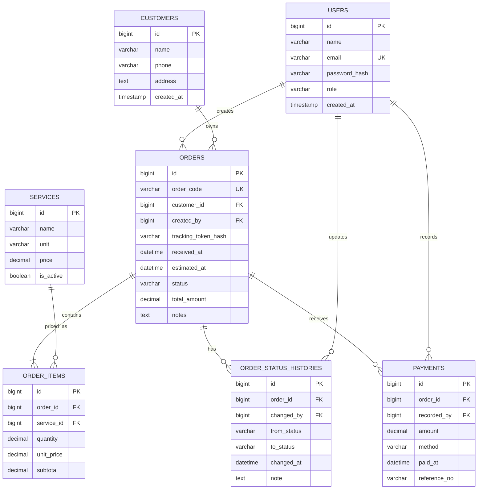

# ERD dan Skema Database Queen Laundry

ERD berikut adalah **rancangan yang direkomendasikan**, bukan ERD yang sudah ditetapkan proposal. Mendukung PHP/MySQL dan kebutuhan transaksi, tracking, serta laporan kas.

## ERD Mermaid


## Data dictionary
| Tabel | PK | FK | Keterangan |
|---|---|---|---|
| users | id | - | admin pemilik; pelanggan tanpa akun pada opsi tracking token |
| customers | id | - | identitas pelanggan |
| services | id | - | jenis layanan dan tarif terkini |
| orders | id | customer_id → customers; created_by → users | header transaksi, status, total, token tracking hash |
| order_items | id | order_id → orders; service_id → services | rincian item dengan snapshot harga |
| order_status_histories | id | order_id → orders; changed_by → users | jejak perubahan status |
| payments | id | order_id → orders; recorded_by → users | penerimaan tunai/transfer manual |

## Tipe dan constraints penting
- Semua ID `BIGINT UNSIGNED AUTO_INCREMENT`; FK diindeks, InnoDB.
- `orders.order_code` UNIQUE, `users.email` UNIQUE; token tracking hanya disimpan dalam bentuk hash.
- `services.unit` ENUM('kg','item'); `services.price`, `order_items.unit_price`, `subtotal`, `orders.total_amount`, `payments.amount`: DECIMAL(12,2).
- `order_items.quantity` DECIMAL(10,2) CHECK > 0; `payments.amount` > 0. Validasi ulang di aplikasi.
- `orders.status` dibatasi ke nilai yang disepakati; `payments.method` tunai/transfer.
- Hindari delete pelanggan, layanan, pesanan, atau pembayaran yang sudah terkait transaksi; gunakan nonaktif/void dengan audit jika diperlukan.
- Simpan `created_at`/`updated_at` pada tabel operasional. Transaksi database diperlukan ketika membuat order beserta item, atau pembayaran.

## Contoh laporan pendapatan (MySQL)
```sql
SELECT DATE(p.paid_at) AS tanggal,
       COUNT(*) AS jumlah_pembayaran,
       SUM(p.amount) AS pendapatan_diterima
FROM payments p
WHERE p.paid_at >= :mulai
  AND p.paid_at < :akhir_eksklusif
GROUP BY DATE(p.paid_at)
ORDER BY tanggal;
```
Gunakan parameter binding; `akhir_eksklusif` adalah hari setelah tanggal akhir filter. Jika ada pembatalan/refund, model dan query harus diperluas dengan `payment_status` atau transaksi pengembalian.

## Keputusan desain yang perlu disahkan
- **Akun pelanggan:** proposal menyebut dua hak akses, tetapi pelanggan hanya tracking. Opsi minimal: tanpa login, memakai kode+token. Bila dosen meminta login pelanggan, tambah `users.customer_id` nullable UNIQUE dan role `customer`, lalu batasi order milik akun tersebut.
- **Pendapatan:** laporan berbasis pembayaran yang benar-benar diterima; bila pembimbing meminta laporan nilai order, buat laporan kedua dengan label berbeda.
- **Status:** `diterima`, `dicuci`, `disetrika`, `siap_diambil`, `diambil`, `dibatalkan`; alur khusus cuci tanpa setrika perlu disepakati.
