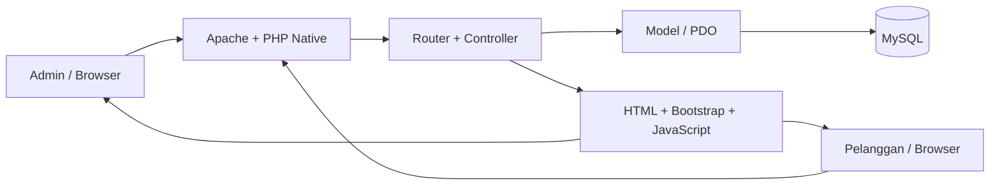
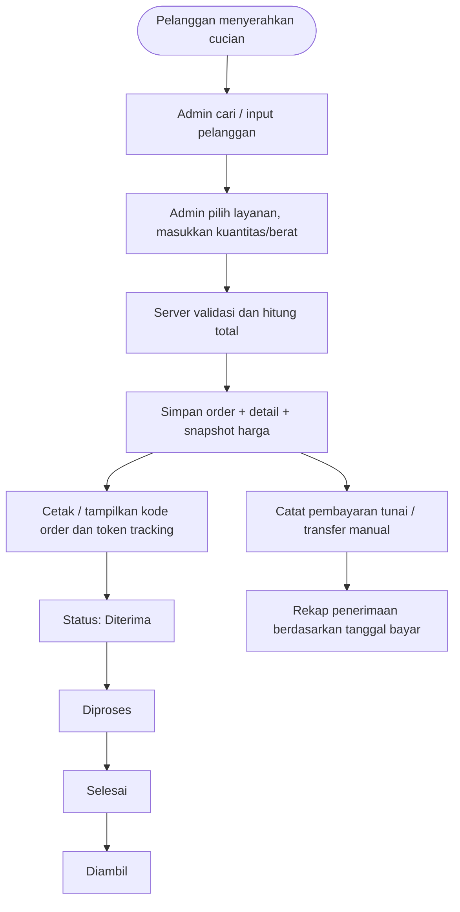
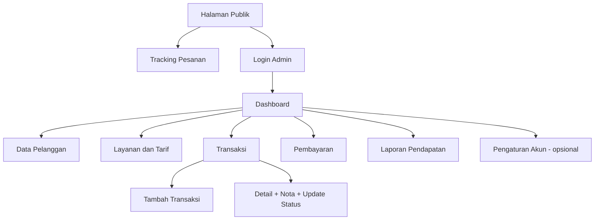
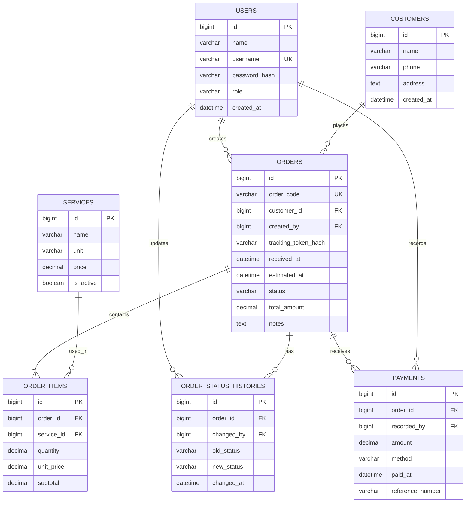

# BLUEPRINT IMPLEMENTASI SISTEM INFORMASI QUEEN LAUNDRY

**Versi:** 1.0 (rancangan, belum diimplementasikan)  
**Acuan:** Proposal Skripsi Denia, *Perancangan Sistem Informasi Pengelolaan Data Laundry Berbasis Website pada Queen Laundry Desa Simpang Belui Kabupaten Kerinci* (2026).  
**Stack disepakati:** PHP Native 8.x, MySQL 8.x, Apache/XAMPP, HTML/CSS/JavaScript, Bootstrap 5, PDO.

> **Status persyaratan:** [P] dinyatakan dalam proposal; [R] rekomendasi desain yang perlu disetujui pemilik/dosen. Dokumen ini adalah blueprint pembangunan, bukan bukti implementasi atau hasil pengujian.

## 1. Tujuan dan ruang lingkup
Menggantikan pencatatan pelanggan/transaksi manual dengan sistem web, menghitung biaya otomatis, memantau status cucian, dan merekap pendapatan periodik. [P]

**Termasuk:** pengelolaan pelanggan, layanan/tarif sebagai pendukung transaksi [R], transaksi dan item transaksi, status pesanan, pembayaran tunai/transfer manual, laporan, tracking pelanggan.  
**Tidak termasuk [P]:** gaji, stok deterjen/pewangi, pajak, payment gateway, WhatsApp gateway.  
**Aktor [P]:** Admin/pemilik (akses penuh) dan Pelanggan (tracking saja). Pelanggan **tidak perlu akun** pada rancangan awal [R]; gunakan kode pesanan + token acak rahasia.

## 2. Arsitektur deployment

**Lingkungan lokal:** XAMPP (Apache, PHP, MySQL), VS Code, phpMyAdmin, Chrome, draw.io; sesuai alat dalam BAB III proposal. [P]  
**Produksi [R]:** hosting PHP/MySQL dengan HTTPS, environment secrets di luar public web root, backup database harian dan uji pemulihan.

## 3. Modul dan hak akses
| Modul | Admin | Pelanggan | Prioritas |
|---|---|---|---|
| Autentikasi login/logout | Kelola sesi sendiri | Tidak wajib login | Wajib |
| Dashboard ringkasan | Lihat KPI & pesanan terbaru | - | Wajib |
| Pelanggan | Tambah, ubah, cari, arsipkan | - | Wajib |
| Layanan & tarif | CRUD/arsip | - | Wajib pendukung [R] |
| Transaksi | Buat, lihat, cari, cetak nota | - | Wajib |
| Status cucian | Ubah status & lihat riwayat | Tracking terbatas | Wajib |
| Pembayaran manual | Catat tunai/transfer | - | Wajib pendukung [R] |
| Laporan | Filter periode, cetak/ekspor | - | Wajib |
| Pengaturan usaha | Identitas usaha, akun admin | - | Opsional [R] |

## 4. Alur bisnis utama

**Status yang diusulkan [R]:** `diterima`, `diproses`, `selesai`, `diambil`, `dibatalkan`. Perubahan status dicatat dalam histori. Pembatalan hanya admin dan harus beralasan; aturan refund/void perlu dikonfirmasi.

## 5. Sitemap / blueprint halaman


**Layout admin [R]:** sidebar kiri (Dashboard, Pelanggan, Layanan, Transaksi, Pembayaran, Laporan), topbar pencarian/profil, kartu ringkasan, tabel, filter tanggal, tombol aksi jelas, responsif mobile.  
**Layout pelanggan [R]:** form kode pesanan + token, status badge, timeline status, estimasi selesai bila tersedia; jangan tampilkan daftar pelanggan atau transaksi lain.

### Wireframe dashboard admin (konseptual)
```text
+--------------------+-----------------------------------------------------+
| QUEEN LAUNDRY      | Dashboard                       Admin  [Keluar]     |
|--------------------+-----------------------------------------------------|
| Dashboard          | [Order hari ini] [Diproses] [Selesai] [Pendapatan] |
| Pelanggan          |                                                     |
| Layanan            | [ Grafik pendapatan 7/30 hari ]                    |
| Transaksi          |                                                     |
| Pembayaran         | Pesanan Terbaru                                    |
| Laporan            | Kode | Pelanggan | Total | Status | Aksi           |
+--------------------+-----------------------------------------------------+
```

### Form transaksi
Pilih pelanggan, tanggal terima, estimasi selesai, daftar item layanan (layanan, satuan, kuantitas, harga snapshot, subtotal), total, catatan; tombol Simpan dan Cetak Nota. Hitung subtotal di browser untuk kenyamanan tetapi **hitung ulang di server**.

## 6. ERD logis (7 tabel inti)

**Catatan:** `tracking_token_hash` menyimpan hash token; token asli hanya diberikan pada nota pelanggan. Foreign key, indeks, NOT NULL, dan CHECK/validasi diterapkan saat DDL. Status dapat menggunakan VARCHAR + validasi aplikasi. Gunakan `DECIMAL(12,2)` untuk nominal dan kuantitas yang membutuhkan pecahan, jangan FLOAT.

### Aturan data kritis
1. `order_code` unik; dibuat di server, bukan dari input bebas.
2. Total order = SUM(item.quantity × item.unit_price), harga item adalah snapshot tarif ketika order dibuat; perubahan tarif berikutnya tidak mengubah transaksi lama.
3. Simpan order dan item dalam satu transaksi database (`BEGIN/COMMIT/ROLLBACK`).
4. Jumlah pembayaran tidak boleh melebihi total pesanan, kecuali skenario refund yang secara eksplisit dirancang.
5. Laporan **pendapatan kas** = SUM(pembayaran valid menurut `paid_at`), bukan SUM seluruh order. Laporan nilai penjualan/order dapat ditampilkan terpisah. Kebijakan pembayaran parsial perlu konfirmasi.
6. Hindari penghapusan permanen transaksi; gunakan pembatalan dengan audit trail.
7. Nomor telepon dan alamat hanya ditampilkan kepada admin; tracking publik meminimalkan data pribadi.

## 7. Struktur proyek PHP Native (MVC ringan)
```text
queen-laundry/
├── app/
│   ├── Controllers/ (Auth, Dashboard, Customer, Service, Order, Payment, Report, Tracking)
│   ├── Models/ (User, Customer, Service, Order, OrderItem, Payment)
│   ├── Middleware/ (AuthMiddleware, CsrfMiddleware)
│   ├── Views/ (layouts, auth, dashboard, customers, services, orders, payments, reports, tracking)
│   └── Helpers/ (validation, money, csrf)
├── config/ (database.php, app.php)
├── database/ (schema.sql, seed_demo.sql)
├── public/ (index.php, .htaccess, assets/css, assets/js)
├── storage/ (logs, exports)
├── tests/ (blackbox-checklist.md, uat-form.md)
└── README.md
```
**Keamanan minimum:** PDO prepared statements; `password_hash()` / `password_verify()`; session regeneration saat login; CSRF token; escape HTML output; otorisasi semua endpoint admin; validasi server; rate-limit login dan tracking; jangan menyimpan kredensial di Git; `public/` sebagai document root.

## 8. Rancangan route (contoh, bukan endpoint yang sudah berjalan)
| Metode | URL | Akses | Fungsi |
|---|---|---|---|
| GET | `/` | Publik | Beranda / tracking |
| GET/POST | `/tracking` | Publik | Cari status dengan kode + token |
| GET/POST | `/login` | Publik | Login admin |
| POST | `/logout` | Admin | Logout |
| GET | `/admin/dashboard` | Admin | Ringkasan |
| GET/POST | `/admin/customers` | Admin | Daftar / tambah pelanggan |
| GET/POST | `/admin/services` | Admin | Daftar / tambah layanan |
| GET/POST | `/admin/orders` | Admin | Daftar / tambah transaksi |
| GET/POST | `/admin/orders/{id}` | Admin | Detail / ubah status |
| GET/POST | `/admin/payments` | Admin | Catat pembayaran |
| GET | `/admin/reports?from=&to=` | Admin | Laporan periodik |

## 9. Kebutuhan nonfungsional dan penerimaan
- **Keamanan:** role admin, session aman, CSRF, SQL injection dicegah, tidak ada data pelanggan bocor lewat tracking.
- **Keandalan:** validasi input, atomic order, backup database, pesan error yang jelas.
- **Kegunaan:** formulir ringkas, tampilan responsif, status mudah dibaca.
- **Performa:** pagination daftar dan indeks pada `order_code`, `customer_id`, `received_at`, `paid_at`.
- **Pengujian proposal [P]:** Black Box Testing dan User Acceptance Testing (UAT). Target performa numerik belum ditetapkan proposal.

### Skenario Black Box minimum
| ID | Skenario | Hasil yang diharapkan |
|---|---|---|
| BB01 | Login benar/salah | Masuk admin / pesan gagal tanpa bocor detail |
| BB02 | CRUD pelanggan | Tersimpan, dapat dicari dan diperbarui |
| BB03 | Input berat/kuantitas negatif | Ditolak |
| BB04 | Transaksi multi-item | Total server akurat, order dan item konsisten |
| BB05 | Perubahan harga layanan | Order lama tidak berubah |
| BB06 | Update status | Status dan histori tercatat |
| BB07 | Tracking kode/token valid/tidak valid | Hanya order yang sah terlihat |
| BB08 | Catat pembayaran | Saldo dan laporan sesuai |
| BB09 | Filter laporan tanggal | Menampilkan pembayaran dalam periode tepat |
| BB10 | Akses URL admin tanpa login | Ditolak/redirect |

**UAT:** admin mencoba pembuatan transaksi sampai laporan, pelanggan mencoba tracking; kumpulkan jawaban, catat masalah dan persetujuan. Jangan mengklaim hasil UAT sebelum pelaksanaan.

## 10. Urutan pembangunan dan bukti BAB IV
| Fase | Implementasi | Bukti skripsi |
|---|---|---|
| 1 | Finalisasi kebutuhan & aturan tarif | Tabel kebutuhan dan persetujuan |
| 2 | ERD, DDL, relasi & data dummy | Gambar ERD, struktur tabel |
| 3 | Router, koneksi PDO, login & sesi | Screenshot login dan dashboard |
| 4 | CRUD pelanggan dan layanan | Screenshot form dan daftar |
| 5 | Transaksi multi-item, kalkulasi & nota | Screenshot input dan hasil |
| 6 | Status dan tracking | Screenshot admin dan pelanggan |
| 7 | Pembayaran manual dan laporan | Screenshot filter dan rekap |
| 8 | Black Box, UAT, perbaikan | Tabel pengujian dan hasil nyata |

**Struktur BAB IV yang disarankan:** 4.1 Gambaran Umum Queen Laundry; 4.2 Analisis Kebutuhan; 4.3 Desain Sistem (UML/ERD/UI); 4.4 Implementasi (database, modul, screenshot); 4.5 Pengujian Black Box; 4.6 UAT; 4.7 Pembahasan dan keterbatasan. Sesuaikan dengan pedoman kampus.

## 11. Hal yang harus dikonfirmasi sebelum coding
1. Daftar layanan asli, satuan (kg/item), harga, minimal berat, dan aturan pembulatan.
2. Status yang benar-benar dipakai Queen Laundry dan apakah ada tahap setrika/packing.
3. Apakah pembayaran boleh DP/cicilan, kapan dianggap lunas, dan cara pembatalan.
4. Apakah pelanggan perlu login/riwayat transaksi. **Proposal membatasi pelanggan pada tracking**, meski manfaat menyebut rincian biaya dan riwayat; perubahan hak akses perlu persetujuan.
5. Informasi apa yang boleh terlihat pada halaman tracking publik.
6. Format nota dan format laporan pendapatan yang diminta pemilik.
7. Apakah website hanya dijalankan lokal atau dihosting online; proposal menyebut akses web tetapi belum menetapkan penyedia hosting.

## 12. Keterlacakan sumber
- **Proposal BAB I, Batasan Masalah:** modul pelanggan, transaksi otomatis, status, laporan; aktor; PHP/MySQL; fitur yang dikecualikan.
- **Proposal BAB III:** metode Waterfall; XAMPP, VS Code, Chrome, phpMyAdmin, draw.io; implementasi PHP/MySQL; Black Box dan UAT.
- **Teknologi Implementasi:** PHP Native (PDO) + MySQL / MariaDB (XAMPP).
- **Rekomendasi blueprint:** detail 7 tabel, token tracking, struktur MVC, rute, UI, pengamanan, aturan transaksi dan urutan implementasi; semuanya perlu divalidasi saat analisis kebutuhan.

**Dokumen pendamping:** `01_ANALISIS_KEBUTUHAN.md`, `02_DESAIN_WEB.md`, `03_ERD_DATABASE.md`, `04_ROADMAP_BAB4_PENGUJIAN.md`.
